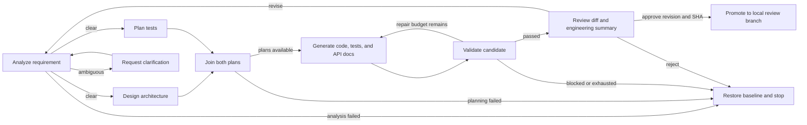

# Agentic URL Shortener

A FastAPI URL shortener and a local engineering workflow that turns a requirement into a tested Git commit for human review. The service creates short links, redirects visitors, counts successful redirects, and supports optional expiry. The workflow uses LangGraph to coordinate requirement analysis, design, implementation, and verification.

## Installation

Use Linux, Git, and [uv](https://docs.astral.sh/uv/). The commands below use Python 3.13. Run them from the repository root.

```sh
uv sync --python 3.13
uv run pytest -q
```

The workflow demos also require a running Docker daemon that your account can access. Build the validator image once. The build downloads dependencies. Candidate validation uses the local image with networking disabled.

```sh
docker build -f Dockerfile.validator -t shortener-validator:local .
```

## Run the URL shortener

```sh
uv run uvicorn shortener.app:serve --factory
```

In another terminal, create a link that expires after five minutes.

```sh
curl -s http://127.0.0.1:8000/urls \
  -H 'Content-Type: application/json' \
  -d '{"url":"https://example.com/","expires_in_seconds":300}'
```

Copy the returned `code` into these commands. The first prints the redirect response. The second shows the link's click count and expiry.

```sh
CODE=replace_with_returned_code
curl -i "http://127.0.0.1:8000/$CODE"
curl -s "http://127.0.0.1:8000/urls/$CODE/analytics"
```

The service uses `links.sqlite` by default. Set `SHORTENER_DB` to use a different path. See [API.md](API.md) for the request and response contract or open the interactive API docs at `http://127.0.0.1:8000/docs` while the service is running.

## Run the engineering workflow

The default provider uses deterministic scenario fixtures and requires no API key. Each run creates an isolated Git repository and worktree under `.runs/<run-id>`. Choose a fresh run ID when repeating a demo.

```sh
scenarios/run.sh greenfield green-1
```

The CLI prints the candidate diff, revision, and commit SHA when validation passes. Read the generated summary and inspect the diff before approving.

```sh
uv run python -m workflow status green-1
cat .runs/green-1/review.md
```

Approve the exact revision and SHA printed by the CLI. For example, if the gate displays revision 1, use the following command after replacing the SHA.

```sh
CANDIDATE_SHA=replace_with_displayed_commit_sha
uv run python -m workflow resume green-1 approve --revision 1 --commit "$CANDIDATE_SHA"
git -C .runs/green-1/repository log --oneline review
```

Approval promotes the candidate to the isolated repository's local `review` branch. To serve an approved candidate, run Uvicorn from that candidate's worktree using this project's Python environment.

### Three scenarios

| Scenario | Starting point and validation |
| --- | --- |
| Greenfield | Starts from an empty Git tree. Adds the API, tests, and documentation. Validates link creation, redirects, analytics, and expiry. |
| Brownfield | Starts from an existing service. Adds optional expiry and a schema migration. Integration tests seed the legacy table and verify that links and click counts survive. |
| Ambiguous | Starts from “Make the app more secure and faster.” Pauses for clarification, then replans around strict create payloads and SQLite WAL mode. Tests verify both behaviors. |

```sh
scenarios/run.sh brownfield brown-1
scenarios/run.sh ambiguous unclear-1
uv run python -m workflow resume unclear-1 clarify \
  --text 'Reject unknown create fields and enable SQLite WAL for concurrent readers.'
```

Use the same review procedure for each run. The ambiguous demo reaches approval at revision 2 after clarification. At a review gate, you can also reject a candidate or replace its requirement.

```sh
uv run python -m workflow resume brown-1 reject
uv run python -m workflow resume unclear-1 revise --text 'Provide a revised requirement here'
uv run python -m workflow events
uv run python -m workflow metrics
```

The mock provider supports the built-in scenarios. Use the live provider to try arbitrary requirements within the project's allowed file scope. If an automatic stage is interrupted, use `uv run python -m workflow resume RUN_ID` to continue from its checkpoint.

### Live model configuration

Copy the template and edit `.env` with values for an authorized OpenAI-compatible endpoint that supports JSON mode.

```sh
cp -n .env.example .env
```

```dotenv
WORKFLOW_API_BASE=https://api.openai.com/v1
WORKFLOW_MODEL=your_model_id
WORKFLOW_API_KEY=your_api_key
```

Shell variables override `.env` values. The file is Git-ignored. Provider credentials stay outside the validator. The live provider sends requirements and relevant repository files to the configured endpoint.

```sh
uv run python -m workflow start live-1 greenfield --provider live
```

## How it works



- [Workflow graph](workflow/graph.py) validates task dependencies, runs architecture and test planning in parallel, and waits for both before implementation. SQLite checkpoints carry the requirement, revision, plans, candidate SHA, and approval state across CLI invocations.
- [Model provider](workflow/provider.py) returns structured analysis, plans, and typed file edits. Clarification and revised requirements create a new revision and rerun analysis and design. Failed validation feeds diagnostics back into implementation for up to two repair rounds.
- [Workspace](workflow/workspace.py) and [validator](workflow/validation.py) restrict edits to the service, tests, and API docs. Validation runs in Docker with a non-root identity, read-only source, disabled networking, and resource limits. Set `WORKFLOW_IMAGE` to select a trusted local validator image.
- The [audit module](workflow/audit.py) records stage outputs, failures, retries, rollbacks, and approval decisions. Success rate measures approvals among terminal runs. Recovery time measures the interval from a revision's first recorded failure to its successful validation. End-to-end latency includes human wait time.

## Testing and limitations

Run `uv run pytest -q` for the repository suite. It covers HTTP behavior, legacy migration, workflow synchronization, restart and approval, rejection, bounded repair, safe-stop, replanning, and provider configuration.

The latest local verification passed **17 repository tests**. Docker validation passed **10 greenfield**, **10 brownfield**, and **9 ambiguous** tests. All three deterministic demos reached approval and promoted to their isolated review branches. A successful live-provider run remains to be verified.

The prototype uses a single-user local workspace, SQLite checkpoints, and an editable audit log. The workflow replans on human clarification and requirement revision. Changes to an upstream design or test-plan artifact do not automatically invalidate downstream state. The validator's static checks are heuristic, and candidate code runs in the same pytest process as acceptance tests. The shortener currently has aggregate click counts and relies on SQLite for storage. Authentication, rate limiting, and load benchmarks are outside the current implementation.
