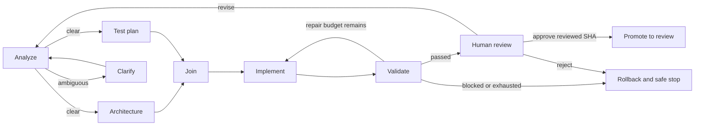

# Agentic URL shortener

A FastAPI URL shortener and a local engineering workflow. One model performs requirement analysis, architecture planning, test planning, and code generation. LangGraph and Python enforce dependencies, validation, and human change control.

## Setup

Use Linux, Python 3.13, Git, uv, and access to a local Docker daemon. Build the validator once from the trusted repository. Docker needs network access for this setup step. Candidate execution uses the prebuilt local image and has networking disabled.

```sh
uv sync --python 3.13
uv run pytest -q
docker build -f Dockerfile.validator -t shortener-validator:local .
uv run uvicorn shortener.app:serve --factory
```

```sh
curl -s -X POST http://127.0.0.1:8000/urls \
  -H 'Content-Type: application/json' \
  -d '{"url":"https://example.com/","expires_in_seconds":300}'
curl -i 'http://127.0.0.1:8000/<code>'
curl -s 'http://127.0.0.1:8000/urls/<code>/analytics'
```

API behavior is described in [API.md](API.md). Set `SHORTENER_DB` to choose the application's SQLite path.

## Three scenarios

Each start command creates an independent repository with a baseline `main` branch and a detached worktree. Use a new run ID to repeat a demo. Commands can be run from separate terminal sessions.

```sh
scenarios/run.sh greenfield green-1
scenarios/run.sh brownfield brown-1
scenarios/run.sh ambiguous unclear-1
uv run python -m workflow resume unclear-1 clarify \
  --text 'Reject unknown create fields and enable SQLite WAL for concurrent readers.'
```

- **Greenfield** begins with an empty Git tree. The model adds the API, tests, and API documentation.
- **Brownfield** begins with an existing create, redirect, and analytics API. The model adds optional expiry and a schema migration. Trusted integration tests seed the legacy table and verify that its URLs and click counts survive.
- **Ambiguous** begins with an existing shortener. It pauses before design and stores the question in SQLite. Clarification replaces the plan with two concrete requirements, strict create payloads and WAL mode. The acceptance tests verify the two behaviors. No speedup is claimed.

The CLI shows the proposed diff, revision, commit, and path to the generated engineering summary. Inspect the summary and diff before approving. Substitute the exact revision and SHA printed for each run.

```sh
uv run python -m workflow status green-1
cat .runs/green-1/review.md
uv run python -m workflow resume green-1 approve --revision 1 --commit <SHA>
git -C .runs/green-1/repository log --oneline --all
uv run python -m workflow resume brown-1 reject
uv run python -m workflow status unclear-1
uv run python -m workflow resume unclear-1 approve --revision 2 --commit <SHA>
uv run python -m workflow events
uv run python -m workflow metrics
```

To replace a requirement before approval, use `resume RUN revise --text 'new requirement'`. This discards unapproved changes, increments the revision, and runs Analyze and both Design branches again. The mock uses fixed scenario implementations. Use the live provider for arbitrary requirements. To resume after an interrupted automatic stage, use `resume RUN` without a decision.

An approved change moves to the run repository's local `review` branch. The run's `main` stays at the initial baseline. To run an approved greenfield or brownfield candidate, use the main project's Python environment with the candidate as the working directory and run `python -m uvicorn shortener.app:serve --factory`.

## Live provider

Configure one OpenAI-compatible Chat Completions endpoint that supports JSON mode.

```sh
export WORKFLOW_MODEL='<model>'
export WORKFLOW_API_KEY='<key>'
# Optional. The default is https://api.openai.com/v1.
export WORKFLOW_API_BASE='<compatible endpoint>/v1'
uv run python -m workflow start live-1 greenfield --provider live
```

Only send repository content and requirements to an endpoint authorized to receive them. Provider credentials stay outside the validator. The validator never fetches packages at runtime. Set `WORKFLOW_IMAGE` to select a trusted, locally built image.

## Architecture and controls



- **State.** LangGraph checkpoints preserve the current revision, tasks, branch outputs, candidate, and human interrupt. SQLite events record decisions, stage outputs, failures, retries, rollback, and promotion. This is a local, inspectable audit trail.
- **Entry and exit gates.** Analysis checks that task IDs are unique and that dependencies refer to earlier tasks. The fan-in waits for both design outputs. Validation resets to the proposed commit and checks the candidate before a human can approve. Approval binds the run, revision, and SHA to the decision.
- **Execution.** The model returns typed file edits. Python enforces a three-path allowlist, rejects symlinks and certain risky Python constructs, and uses fixed Git and Docker arguments. The container runs a fixed pytest command with a non-root identity, read-only source and root filesystem, no network, dropped capabilities, and resource limits. Candidate code never receives the workflow SQLite database, Git metadata, or provider credentials.
- **Failure handling.** Provider requests get at most two attempts per node invocation. Validation can request up to two repair rounds. Unavailable validation stops the run immediately. Rejection, revision and safe-stop reset the worktree to the known baseline. Pending candidate SHAs remain in checkpoints and events. Promotion can be replayed idempotently if the review ref already points to the expected commit.
- **Metrics.** Success rate is approvals divided by terminal runs. Retry and rollback counts include in-progress work. MTTR is the mean time between the first recorded failure in a revision and successful validation of that revision. Unrecovered revisions are counted separately. End-to-end time is measured from creation to terminal outcome and includes human wait time.

## Requirements traceability

| Requirement | Implementation | Evidence |
|---|---|---|
| Create, redirect, analytics, expiry, and input validation | `shortener/app.py`, `API.md` | `tests/test_shortener.py` |
| Ambiguity, decomposition, and brownfield reasoning | Analyze node, typed analysis, baseline source snapshot | Ambiguous and brownfield demos, `test_ambiguity_and_replanning` |
| Parallel design and synchronization | Architecture and test-plan branches with a multi-source edge to Join | `test_parallel_join_and_promotion_after_restart` uses a two-party barrier |
| Durable state, approval, and rejection | SQLite saver, CLI interrupts, SHA-bound review ref | Approval after reopening SQLite, stale SHA and rejection tests |
| Retry, fallback, rollback, and safe-stop | Bounded model and repair attempts, baseline restore | Repair, exhaustion, and missing-runner tests |
| Change control and sandbox | Path restrictions, AST checks, fixed Docker runner, isolated Git | Policy tests and Docker-backed scenario validation |
| Dynamic re-planning | Revision increment, baseline reset, fresh analysis and design | `test_ambiguity_and_replanning` |
| Observability and final engineering summary | SQLite events and metrics, per-run `review.md` | Events and metrics commands, review summary at approval |
| Setup, tests, three scenarios, and trade-offs | README, fixtures, scenario entry point | Setup and demo commands above |

## Limitations and verification

This is a single-user local prototype for small Python projects. It keeps Git workspaces on disk and uses OS-account access controls. The audit log is neither tamper-evident nor independently authenticated. Recovery covers durable graph checkpoints and idempotent promotion. A crash during initial repository creation may require a new run ID. The mock provider only demonstrates known scenarios.

The AST policy is heuristic, and candidates may still contain bugs or attempt to manipulate in-process test results. Review both code and evidence before accepting a change. Docker uses the host kernel, so deploy the validator on a dedicated runner before processing untrusted submissions outside this assignment. The shortener intentionally redirects to caller-specified destinations. It has no authentication, rate limiting, distributed analytics, or load benchmark.

The unit and integration suite uses a deterministic provider and simulated validation results to test orchestration. The scenario CLI always uses Docker. At implementation time, Python syntax checks and local Git/SQLite smoke checks ran. PyPI dependency resolution was unavailable, and the current account could not access the Docker daemon. Full pytest, Docker-backed scenarios, and live-provider execution require a configured environment.
